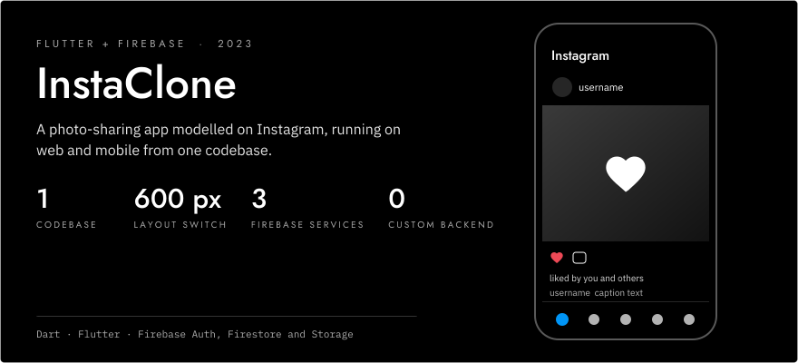
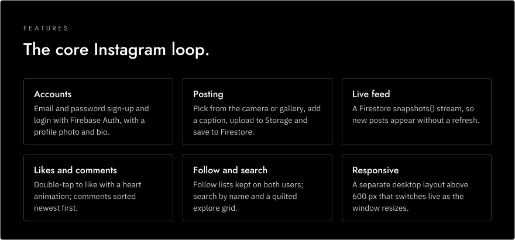
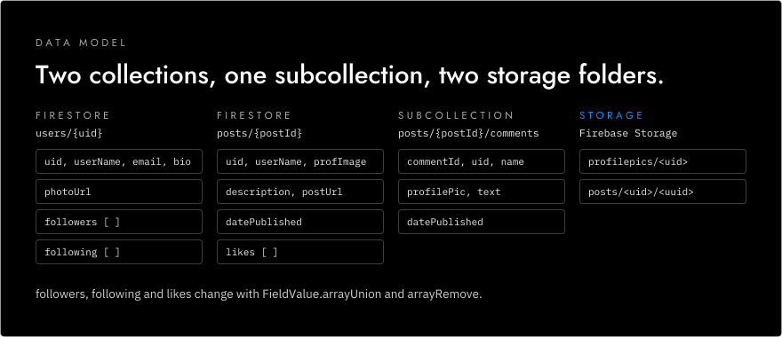
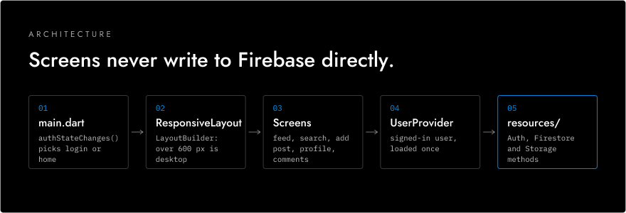

<p align="center">
  <picture>
    <source media="(prefers-color-scheme: dark)" srcset="assets/readme/hero-dark.svg">
    <source media="(prefers-color-scheme: light)" srcset="assets/readme/hero-light.svg">
    
  </picture>
</p>

<p align="center">
  <strong>A photo-sharing app modelled on Instagram, built with Flutter and Firebase.</strong><br>
  <strong>Posts &middot; live feed &middot; likes and comments &middot; follows &middot; search</strong><br>
  <sub>One Dart codebase for web and mobile. Firebase handles accounts, data and image storage.</sub>
</p>

<p align="center">
  
  
  
</p>

<!-- TODO: demo link or video -->

<p align="center">
  
  
  
  
</p>

---

Users sign up with a profile photo and bio, post pictures from the camera or gallery, and scroll a live feed. They can like posts with a double tap, comment, follow other users and search for them.

## Features

<p align="center">
  <picture>
    <source media="(prefers-color-scheme: dark)" srcset="assets/readme/features-dark.svg">
    <source media="(prefers-color-scheme: light)" srcset="assets/readme/features-light.svg">
    
  </picture>
</p>

The app listens to `authStateChanges()` and switches between the login screen and the home screen on its own. Posts come from a Firestore `snapshots()` stream, so new ones appear without a refresh. The explore grid lays out all posts in a quilted 3-column layout, and your own profile has a Sign Out button.

## Data model

<p align="center">
  <picture>
    <source media="(prefers-color-scheme: dark)" srcset="assets/readme/data-model-dark.svg">
    <source media="(prefers-color-scheme: light)" srcset="assets/readme/data-model-light.svg">
    
  </picture>
</p>

Likes and follows use Firestore's `FieldValue.arrayUnion` and `arrayRemove`. The update happens on the server, so two users liking the same post at once don't overwrite each other. Following updates both sides of the relationship: the target's `followers` array and the current user's `following` array.

Each user has one avatar file at `profilepics/<uid>` and as many post images as they upload at `posts/<uid>/<uuid>`, so nothing collides.

## Architecture

<p align="center">
  <picture>
    <source media="(prefers-color-scheme: dark)" srcset="assets/readme/architecture-dark.svg">
    <source media="(prefers-color-scheme: light)" srcset="assets/readme/architecture-light.svg">
    
  </picture>
</p>

The UI is split into `screens/`, reusable `widgets/` and `responsive/` layouts. All Firebase calls go through three classes in `resources/` (`AuthMethods`, `FirestoreMethods` and `StorageMethods`), so screens never write to Firestore or Storage directly. The signed-in user's profile is loaded once into a `UserProvider` when the home layout mounts, and screens read it from there instead of fetching it again. `ResponsiveLayout` uses a `LayoutBuilder`, so resizing a browser window switches between the layouts live.

## Getting started

Requires the Flutter SDK (Dart 3.1.2 or later) and a Firebase project with Auth (email/password), Firestore and Storage turned on.

```sh
git clone https://github.com/haashirk20/instaClone.git
cd instaClone/insta_flutter
flutter pub get
flutter run -d chrome --web-renderer html
```

Newer Flutter releases removed the `--web-renderer` flag. On those, run `flutter run -d chrome`. <!-- verify: Flutter version that builds this project -->

The web Firebase config is set in `lib/main.dart` and the Android config in `android/app/google-services.json`. To use your own Firebase project, replace both. Running `flutterfire configure` is the usual way to generate them.

## Known limitations

- The delete option shows on every post, not only your own, and nothing in the client checks ownership. Firestore security rules would need to enforce it.
- The Favourites tab in the bottom bar is a placeholder.
