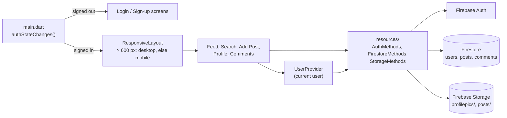

# InstaClone

A photo-sharing app modelled on Instagram, built with Flutter and Firebase. It runs on web and mobile from one codebase, with a separate layout for wide screens.


> The app's source is on the [`develop`](https://github.com/haashirk20/instaClone/tree/develop) branch. `main` still holds the starter Flutter project.

## Demo

<!-- TODO: demo link or video -->


## Overview

InstaClone covers the core Instagram loop. Users sign up with a profile photo and bio, post pictures from the camera or gallery, and scroll a live feed. They can like posts with a double tap, comment, follow other users and search for them. Firebase handles accounts, data and image storage, so the app has no custom backend.

## Key features

- Email and password sign-up and login with Firebase Auth. The app listens to `authStateChanges()` and switches between the login screen and the home screen on its own.
- Posting from the camera or gallery with a caption. Images go to Firebase Storage and post records to Firestore.
- A real-time feed from a Firestore `snapshots()` stream, so new posts appear without a refresh.
- Double-tap to like with a heart animation, and a like button that toggles.
- Comments on each post in a subcollection, newest first, plus a comment count on the post card.
- Follow and unfollow, with follower and following lists kept on both user documents.
- User search by name, and an explore grid of all posts in a quilted 3-column layout.
- Profile pages with the user's posts, stats, and a Sign Out button on your own profile.
- Deleting a post from the menu on each post card.
- A responsive layout that switches to a desktop design above 600 px wide.

## Tech stack

| Area | Tools |
|---|---|
| Language and UI | Dart, Flutter (Material, dark theme) |
| Auth | Firebase Auth |
| Database | Cloud Firestore |
| File storage | Firebase Storage |
| State | Provider (`ChangeNotifier`) |
| Other packages | `image_picker`, `flutter_staggered_grid_view`, `flutter_svg`, `uuid`, `intl` |

## Architecture

The UI is split into `screens/`, reusable `widgets/` and `responsive/` layouts. All Firebase calls go through three classes in `resources/`, so screens never touch Firestore or Storage directly for writes.



## Technical highlights

- Likes and follows use Firestore's `FieldValue.arrayUnion` and `arrayRemove`. The update happens on the server, so two users liking the same post at once don't overwrite each other.
- Following updates both sides of the relationship: the target's `followers` array and the current user's `following` array.
- Storage paths are `profilepics/<uid>` for avatars and `posts/<uid>/<uuid>` for posts. Each user has one avatar file and as many post images as they upload, and nothing collides.
- The signed-in user's profile is loaded once into a `UserProvider` when the home layout mounts, and screens read it from there instead of fetching it again.
- `ResponsiveLayout` uses a `LayoutBuilder`, so resizing a browser window switches between the mobile and desktop layouts live.

## Getting started

Requires the Flutter SDK (Dart 3.1.2 or later) and a Firebase project with Auth (email/password), Firestore and Storage turned on.

```sh
git clone -b develop https://github.com/haashirk20/instaClone.git
cd instaClone/insta_flutter
flutter pub get
flutter run -d chrome --web-renderer html
```

Newer Flutter releases removed the `--web-renderer` flag. On those, run `flutter run -d chrome`. <!-- verify: Flutter version that builds this project -->

The web Firebase config is set in `lib/main.dart` and the Android config in `android/app/google-services.json`. To use your own Firebase project, replace both. Running `flutterfire configure` is the usual way to generate them.

## Known limitations

- The delete option shows on every post, not only your own, and nothing in the client checks ownership. Firestore security rules would need to enforce it.
- The Favourites tab in the bottom bar is a placeholder.
